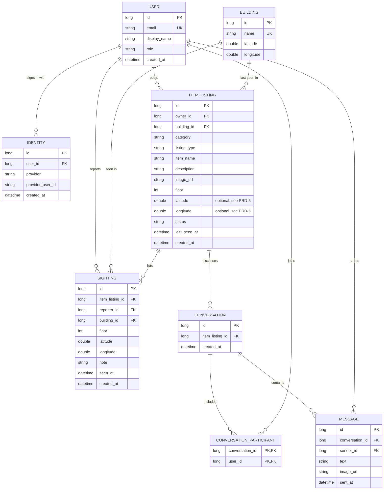

# Entity relationship diagram

Based on the ERD in `docs/prd.md` (PR #6), with the changes below so the tables can hold what the
user stories require. **Only `BUILDING` exists so far** (`V2__buildings.sql`). The rest is the plan,
and each table gets its migration when its story is built.

## Changes from the PRD's ERD

| Change | Why |
|---|---|
| Added `BUILDING`, and `ITEM_LISTING.building_id` replaces `location_label` | PRD-4 and PRD-7 require a building, and the picker needs a fixed list |
| Added `SIGHTING` | PRD-7 and the vertical slice can't be stored without it |
| Added `ITEM_LISTING.floor` and `last_seen_at` | PRD-4 posts a floor and a last-seen time |
| Added `IDENTITY` | Appendix I, section 3.5: one row per provider login, keyed by provider ID and never by email |
| `latitude` and `longitude` are `double` and optional on `ITEM_LISTING` | PRD-5 covers an item with no map pin. Store both or neither |

## When a row is deleted

The course guide says deleting an account removes the user's data, so nothing a user wrote stays
behind.

| Deleted | Also deleted | Blocked? |
|---|---|---|
| `USER` | Their identities, listings, sightings, participants and messages | No |
| `ITEM_LISTING` | Its sightings and conversations | No |
| `CONVERSATION` | Its participants and messages | No |
| `BUILDING` | Nothing | Yes, while a listing or sighting uses it |

## Decisions for the team

- **Conversations and messages after account deletion:** deleting one user's messages leaves the
  other person with half a conversation. Decide this before building PRD-6.
- **`BUILDING` holds outdoor places too:** PRD-4 requires a building, so an item lost on a lawn or in
  a parking lot needs a row like "Main Quad". These aren't seeded yet.
