# Entity relationship diagram

Based on the ERD in `docs/prd.md` (PR #6), with the changes below so the tables can hold what the
user stories require. **`BUILDING`, `USER` and `ITEM_LISTING` exist so far**
(`V2__buildings.sql`, `V3__users.sql`, `V4__item_listings.sql`). The rest is the plan, and each table
gets its migration when its story is built.

A map pin isn't its own table. It's the `latitude` and `longitude` on an `ITEM_LISTING` or `SIGHTING`.
A listing is in one building, so `building_id` is the whole link between the two tables.

```mermaid
erDiagram
    USER ||--o{ ITEM_LISTING : posts
    USER ||--o{ SIGHTING : reports
    BUILDING ||--o{ ITEM_LISTING : "last seen in"
    BUILDING ||--o{ SIGHTING : "seen in"
    ITEM_LISTING ||--o{ SIGHTING : has
    ITEM_LISTING ||--o{ CONVERSATION : discusses
    USER ||--o{ CONVERSATION : starts
    CONVERSATION ||--o{ MESSAGE : contains
    USER ||--o{ MESSAGE : sends

    USER {
        long id PK
        string email UK
        string display_name
        string role
        string oauth_provider
        string oauth_provider_user_id
        datetime created_at
    }

    BUILDING {
        long id PK
        string name UK
        double latitude
        double longitude
    }

    ITEM_LISTING {
        long id PK
        long owner_id FK
        long building_id FK
        string category
        string listing_type
        string item_name
        string description
        string image_url
        int floor
        double latitude "optional, see PRD-5"
        double longitude "optional, see PRD-5"
        string status
        datetime last_seen_at
        datetime created_at
    }

    SIGHTING {
        long id PK
        long item_listing_id FK
        long reporter_id FK
        long building_id FK
        int floor
        double latitude
        double longitude
        string note
        datetime seen_at
        datetime created_at
    }

    CONVERSATION {
        long id PK
        long item_listing_id FK "unique together with requester_id"
        long requester_id FK "the person asking, never the poster"
        datetime created_at
    }

    MESSAGE {
        long id PK
        long conversation_id FK
        long sender_id FK "the requester or the item's poster"
        string text "1 to 1000 characters after trimming"
        string image_url "optional, once uploads exist"
        datetime sent_at
    }
```

## Changes from the PRD's ERD

| Change | Why |
|---|---|
| Added `BUILDING`, and `ITEM_LISTING.building_id` replaces `location_label` | PRD-4 and PRD-7 require a building, and the picker needs a fixed list |
| Added `SIGHTING` | PRD-7 and the vertical slice can't be stored without it |
| Added `ITEM_LISTING.floor` and `last_seen_at` | PRD-4 posts a floor and a last-seen time |
| Added `USER.oauth_provider` and `oauth_provider_user_id`, unique as a pair | Appendix I, section 3.5: sign-in finds the account by provider ID, never by email. Each account has one sign-in provider, so the linking stretch goal would need its own table |
| `latitude` and `longitude` are `double` and optional on `ITEM_LISTING` | PRD-5 covers an item with no map pin. Store both or neither |
| `CONVERSATION.requester_id` replaces `CONVERSATION_PARTICIPANT` | A conversation is always between the person asking and the item's poster, so `requester_id` and the listing's `owner_id` already name both people. That's one less table to keep in step, and `UNIQUE (item_listing_id, requester_id)` stops duplicate conversations |

## When a row is deleted

The course guide says deleting an account removes the user's data, so nothing a user wrote stays
behind.

| Deleted | Also deleted | Blocked? |
|---|---|---|
| `USER` | Their listings, sightings, participants and messages | No |
| `ITEM_LISTING` | Its sightings and conversations | No |
| `CONVERSATION` | Its messages | No |
| `BUILDING` | Nothing | Yes, while a listing or sighting uses it |

## Decisions for the team

- **Conversations and messages after account deletion (proposed with PRD-6):** deleting an account
  deletes every conversation that person is in, for both people, instead of leaving the other person
  half a conversation. Each conversation goes with its requester (`requester_id`) or with the item it's
  about (the poster's listings), so cascading deletes cover it with no extra code.
- **`BUILDING` holds outdoor places too:** PRD-4 requires a building, so an item lost outdoors uses the
  nearest one, with the floor left blank. Rows like "Main Quad" can be added later if that isn't
  precise enough.
